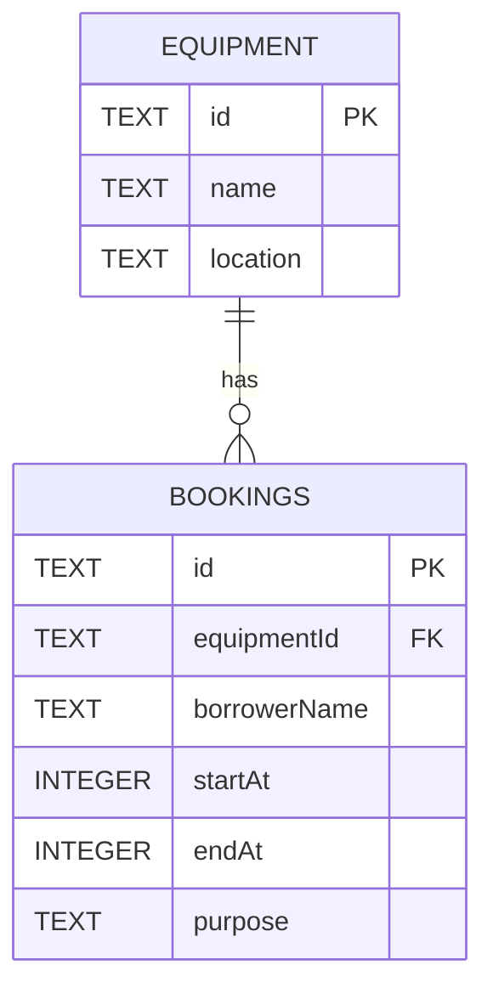

# Data Design: Campus Equipment Booking

**Status:** Implemented by `migrations/0001_initial.sql` and verified in local D1 during Phase 2.  
**Related documents:** [API contract](API_CONTRACT.md) and [project instructions](README.md).

## Runtime decision

The user confirmed TypeScript + Hono with local SQLite through Cloudflare D1 on 2026-10-06. Use Wrangler for local development. No instructor starter has been supplied; incorporate it if it becomes available. Runtime configuration and exact commands belong to Phase 2.

## Relationship



One equipment record can have zero or many bookings. Each booking references exactly one existing equipment record.

## Tables

| Table | Column | SQLite type | Constraints and purpose |
|---|---|---|---|
| equipment | id | TEXT | Explicit NOT NULL primary key; stable equipment identifier |
| equipment | name | TEXT | NOT NULL; non-empty after trimming |
| equipment | location | TEXT | NOT NULL; non-empty after trimming |
| bookings | id | TEXT | Explicit NOT NULL primary key; server-generated UUID |
| bookings | equipmentId | TEXT | NOT NULL; foreign key to equipment.id; restrict deletion of referenced equipment |
| bookings | borrowerName | TEXT | NOT NULL; non-empty after trimming |
| bookings | startAt | INTEGER | NOT NULL; integer UTC epoch milliseconds |
| bookings | endAt | INTEGER | NOT NULL; integer UTC epoch milliseconds; greater than startAt |
| bookings | purpose | TEXT | NOT NULL; non-empty after trimming |

API payloads and responses use ISO timestamp strings. The application parses and validates the strings, stores numeric instants, and formats returned values in UTC. Numeric storage avoids lexical comparison errors between differing timezone offsets. The migration should enforce integer storage for both time fields as well as `startAt < endAt`.

Create an index on `bookings(equipmentId, startAt, endAt)` to narrow conflict searches by equipment and time. A unique constraint on these fields alone cannot prevent partially overlapping reservations.

## Seed data

| id | name | location |
|---|---|---|
| eq-1 | Projector A | Building 1 |
| eq-2 | Camera A | Building 2 |

Start with no bookings. Make seeding reproducible without duplicating equipment or deleting existing bookings. Provide a separate explicit test reset process in Phase 2.

## Integrity and conflict enforcement

The application validates payload shape, text values, calendar timestamps, equipment existence, and chronological order before writing. Database constraints provide a second layer for required values, foreign keys, integer times, and start/end order.

Detect overlap with bound values:

```sql
SELECT id
FROM bookings
WHERE equipmentId = ?
  AND startAt < ?
  AND endAt > ?
LIMIT 1;
```

Bind the equipment ID, requested end time, and requested start time in that order. For an update, add `AND id <> ?` before `LIMIT 1` and bind the current booking ID. Never concatenate request values into SQL.

Treat `[startAt, endAt)` as the reservation interval: endpoints that touch do not overlap. Reservations for different equipment are independent.

### Concurrent writes

A separate application-level check followed by a write leaves a race where two requests may both observe availability. The implementation must enforce the rule at the database write boundary as well.

Proposed approach: SQLite BEFORE INSERT and BEFORE UPDATE triggers reject writes when a same-equipment overlap exists; the update check excludes `NEW.id`. Use a recognizable internal conflict marker and translate only that known failure to HTTP `409`. Other database failures must not be misreported as booking conflicts.

The migration was applied successfully with Wrangler 4.147.0 against local D1. Insert and update conflicts returned `409`; simultaneous conflicting creates returned one `201` and one `409`, with one saved reservation. See [HTTP evidence](TEST_EVIDENCE.md). Phase 3 isolated D1 tests verified direct foreign-key, chronological CHECK, and integer CHECK rejection; see [database evidence](TEST_EVIDENCE.md#database-constraint-cases). No transaction API is assumed.

## Planned implementation artifacts

- [x] A versioned migration creating both tables, constraints, index, and atomic conflict enforcement.
- [x] A seed file containing the two equipment records.
- [x] Local persistent database configuration and documented setup/reset commands.
- [x] Parameterized CRUD queries; conflict checks enforced by database triggers.
- [x] Evidence for create/update conflicts, touching intervals, different equipment, concurrent writes, and persistence after restart.

Do not mark these items complete until the implementation and verification exist.
